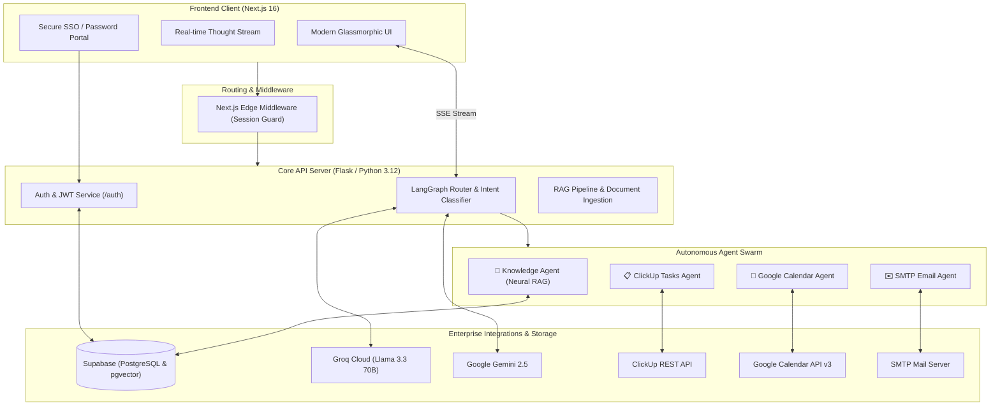

# 🤖 Enterprise AI Assistant

> **Autonomous Multi-Agent Intelligence, Neural RAG & Private Enterprise Knowledge Platform**

[](https://nextjs.org/)
[](https://react.dev/)
[](https://www.python.org/)
[](https://flask.palletsprojects.com/)
[](https://www.langchain.com/langgraph)
[](https://supabase.com/)
[](https://groq.com/)
[](https://deepmind.google/technologies/gemini/)

---

## 📋 Table of Contents

- [Overview](#-overview)
- [System Architecture](#-system-architecture)
- [Multi-Agent Ecosystem](#-multi-agent-ecosystem)
- [Security & Authentication](#-security--authentication)
- [Key Features](#-key-features)
- [Project Directory Structure](#-project-directory-structure)
- [Prerequisites](#-prerequisites)
- [Quick Start Guide](#-quick-start-guide)
  - [1. Clone Repository](#1-clone-repository)
  - [2. Backend Setup](#2-backend-setup)
  - [3. Frontend Setup](#3-frontend-setup)
- [Environment Configuration](#-environment-configuration)
- [API Reference](#-api-reference)
- [Troubleshooting](#-troubleshooting)

---

## 🌟 Overview

The **Enterprise AI Assistant** is a self-hosted, enterprise-grade multi-agent platform designed to unify an organization's private documents, operational workflows, and team tools into a single, intelligent interface.

Built upon a zero-trust model, the platform routes user intents dynamically between specialized autonomous agents—orchestrating semantic document retrieval, project task creation, calendar scheduling, and email dispatch—while streaming the multi-step reasoning trace in real time.

---

## 🏛 System Architecture



---

## 🤖 Multi-Agent Ecosystem

The system implements an autonomous swarm governed by a central dynamic router and state graph (`LangGraph`):

| Agent | Purpose | Technologies |
| :--- | :--- | :--- |
| **⚡ Router Agent** | Intent classification, multi-step execution planning, fallback routing, and real-time SSE event streaming. | LangGraph, LangChain, Groq, Gemini |
| **🧠 Knowledge Agent** | Ingests PDFs, chunks text, creates dense vector embeddings, and performs cosine similarity search with verifiable citations. | `PyMuPDF`, `sentence-transformers`, Supabase pgvector |
| **📋 ClickUp Agent** | Automated task management, querying sprint backlogs, assigning tasks, and creating action items directly from natural language. | ClickUp REST API v2 |
| **📅 Calendar Agent** | Queries schedules, resolves meeting conflicts, and coordinates Google Calendar events. | Google Calendar API v3, Google OAuth 2.0 |
| **✉️ SMTP Email Agent** | Automated drafting, formatting, and secure delivery of notifications and executive summaries via SMTP. | Python `smtplib`, TLS 1.3 |

---

## 🔒 Security & Authentication

The platform implements an **Industrial Best Practice Authentication Architecture**:

- **Backend-Driven JWT Lifecycle**: The Flask server is the single authority for JWT creation, signing (`PyJWT`, `HS256`, 7-day expiration), and verification. No shared secrets or cryptographic keys leak to the client.
- **Secure `HttpOnly` Cookies**: Access tokens are stored exclusively in `HttpOnly; SameSite=Lax; Path=/` cookies named `access_token`, protecting against Cross-Site Scripting (XSS) and token theft.
- **Authentication Modes**:
  1. **Google Workspace SSO (Primary & Recommended)**: One-click Web OAuth 2.0 flow (`/auth/google`) requesting identity (`openid`, `email`, `profile`) and calendar permissions in a single consent step. Automatically provisions user accounts in Supabase upon first login with zero manual administration required.
  2. **Enterprise Password**: Direct verification against the database `users` table with support for both `bcrypt` password hashes and plain credentials.
- **Route Protection**:
  - **Next.js Middleware**: Guards `/chat` and root `/`, preventing unauthenticated access.
  - **API Decorator**: Flask `@token_required` decorator validates cookies and `Authorization: Bearer <token>` on all protected API endpoints (`/chat`, `/chat/stream`, `/documents`, `/documents/upload`).

---

## ✨ Key Features

- **⚡ Real-Time Thought Streaming**: Uses Server-Sent Events (SSE) to render agent thought steps (`thinking`, `plan_created`, `step_start`, `step_complete`, `token`) live in the UI.
- **🌐 Multi-Model Flexibility**: Switch on the fly between **Auto (Fast Router)**, **Groq Llama 3.3 70B**, and **Google Gemini 2.5**.
- **📄 Document RAG Hub**: Drag-and-drop PDF ingestion with automated chunking, vector embedding, and real-time document library view.
- **🎨 Enterprise Dark Aesthetic**: Glassmorphic dark portal matching modern enterprise design with active system status and SLA indicators.
- **📱 Fully Responsive**: Desktop multi-column workspace with collapsible sidebar, session history, and mobile-friendly drawer.

---

## 📁 Project Directory Structure

```text
enterprise-ai-assistant/
├── backend/                         # Flask Backend Application
│   ├── agents/                      # Multi-Agent Swarm
│   │   ├── base/                    # Router Agent, Tool registry, Base Agent
│   │   ├── calendar/                # Google Calendar Agent & Tools
│   │   ├── clickup/                 # ClickUp Task Agent & Tools
│   │   ├── email/                   # SMTP Email Dispatch Agent
│   │   ├── graph/                   # LangGraph Orchestrator & State Machine
│   │   └── knowledge/               # Neural RAG Agent & Vector Retrieval
│   ├── google_calendar/             # Google Calendar Service & OAuth
│   ├── rag/                         # Document Ingestion, Loader & Chunker
│   ├── routes/                      # Flask Blueprints
│   │   ├── auth.py                  # JWT Auth, Google OAuth & Supabase Verification
│   │   ├── chat.py                  # Chat Endpoint & SSE Streaming
│   │   ├── documents.py             # Document Upload & Vector Ingestion
│   │   └── google_calendar.py       # Calendar Test Endpoints
│   ├── services/                    # LLM Provider Adapters (Groq, Gemini)
│   ├── main.py                      # Flask Server Entrypoint
│   ├── requirements.txt             # Python Dependencies
│   └── .env.example                 # Backend Environment Template
│
├── frontend/                        # Next.js 16 Web Application
│   ├── src/
│   │   ├── app/
│   │   │   ├── chat/page.tsx        # Protected AI Assistant Chat Workspace
│   │   │   ├── login/page.tsx       # Auth Redirection & Handler
│   │   │   ├── page.tsx             # Root Multi-Agent Showcase & Login Portal
│   │   │   ├── layout.tsx           # Global Root Layout & Inter Font
│   │   │   └── middleware.ts        # Session Guard & Edge Protection
│   │   ├── components/
│   │   │   ├── auth/                # AuthCard, LoginForm, Google Button
│   │   │   └── chat/                # ChatSidebar, ChatWindow, ThoughtStream
│   │   ├── hooks/                   # useChat Custom Hook (SSE handling)
│   │   ├── lib/                     # API Client, Session Helpers, Supabase SDK
│   │   └── types/                   # TypeScript Type Definitions
│   ├── package.json                 # Node.js Dependencies
│   └── .env.example                 # Frontend Environment Template
│
└── README.md                        # Master Documentation
```

---

## ⚙️ Prerequisites

Before getting started, make sure you have the following installed:

- **Node.js**: v18.17.0 or higher ([Download](https://nodejs.org/))
- **Python**: v3.11 or v3.12 ([Download](https://www.python.org/))
- **Supabase Account**: A free cloud PostgreSQL database ([supabase.com](https://supabase.com))
- **API Keys**:
  - [Groq API Key](https://console.groq.com)
  - [Google AI Studio API Key](https://aistudio.google.com/)
  - [ClickUp API Key & List ID](https://app.clickup.com) (Optional, for task management)
  - [Google Cloud OAuth 2.0 Client](https://console.cloud.google.com/apis/credentials) (For Google SSO & Calendar)

---

## 🚀 Quick Start Guide

### 1. Clone Repository

```bash
git clone https://github.com/your-username/enterprise-ai-assistant.git
cd enterprise-ai-assistant
```

---

### 2. Backend Setup

1. Open a terminal and navigate to `backend/`:
   ```bash
   cd backend
   ```

2. Create and activate a Python virtual environment:
   ```powershell
   # Windows PowerShell:
   python -m venv venv
   .\venv\Scripts\Activate.ps1

   # macOS / Linux:
   python3 -m venv venv
   source venv/bin/activate
   ```

3. Install required Python packages:
   ```bash
   pip install -r requirements.txt
   ```

4. Create your `.env` configuration file:
   ```bash
   cp .env.example .env
   ```
   *(Fill in your database credentials and API keys as described in [Environment Configuration](#-environment-configuration).)*

5. Start the backend development server:
   ```bash
   python main.py
   ```
   *The Flask API will run on `http://localhost:5000`.*

---

### 3. Frontend Setup

1. In a separate terminal, navigate to `frontend/`:
   ```bash
   cd frontend
   ```

2. Install dependencies:
   ```bash
   npm install
   ```

3. Create your `.env` configuration file:
   ```bash
   cp .env.example .env
   ```
   *(Add your `NEXT_PUBLIC_SUPABASE_URL` and `NEXT_PUBLIC_SUPABASE_ANON_KEY`.)*

4. Run the Next.js development server:
   ```bash
   npm run dev
   ```
   *The application will be live at `http://localhost:3000`.*

---

## 🔑 Environment Configuration

### Backend (`backend/.env`)

```env
# Supabase Configuration
SUPABASE_URL=https://your-project.supabase.co
SUPABASE_KEY=your-supabase-service-or-anon-key

# LLM Providers
GEMINI_API_KEY=your-google-gemini-api-key
GROQ_API_KEY=your-groq-api-key

# ClickUp Integration
CLICKUP_API_KEY=pk_your_clickup_api_key
CLICKUP_LIST_ID=your_clickup_list_id

# SMTP Email Configuration
SMTP_HOST=smtp.gmail.com
SMTP_PORT=587
SMTP_USER=your-email@gmail.com
SMTP_PASSWORD=your-gmail-app-password
EMAIL_FROM=your-email@gmail.com

# JWT Authentication
JWT_SECRET=enterprise-ai-assistant-jwt-secret-key-production-super-secure-32bytes-min

# Google OAuth 2.0 Credentials
GOOGLE_CLIENT_ID=your-client-id.apps.googleusercontent.com
GOOGLE_CLIENT_SECRET=your-client-secret
GOOGLE_REDIRECT_URI=http://localhost:5000/auth/google/callback

# Network & Server Settings
PORT=5000
FRONTEND_URL=http://localhost:3000
BACKEND_URL=http://localhost:5000
```

### Frontend (`frontend/.env`)

```env
NEXT_PUBLIC_SUPABASE_URL=https://your-project.supabase.co
NEXT_PUBLIC_SUPABASE_ANON_KEY=your-supabase-anon-key
NEXT_PUBLIC_API_URL=http://localhost:5000
NEXT_PUBLIC_GOOGLE_CLIENT_ID=your-client-id.apps.googleusercontent.com
```

---

## 📡 API Reference

### Authentication Endpoints

| Method | Endpoint | Description | Auth Required |
| :--- | :--- | :--- | :--- |
| `POST` | `/auth/login` | Authenticate with username & password. Issues HttpOnly JWT cookie. | No |
| `GET` | `/auth/google` | Initiates Google Workspace OAuth 2.0 redirect flow. | No |
| `GET` | `/auth/google/callback` | Google OAuth callback; syncs user, sets session, and redirects to `/chat`. | No |
| `POST` | `/auth/google` | Verifies Google ID token from frontend popup / One Tap. | No |
| `GET` | `/auth/me` | Validates session cookie and returns user profile. | Cookie / Bearer |
| `POST` | `/auth/logout` | Clears the `access_token` session cookie. | No |

### Assistant & Workspace Endpoints

| Method | Endpoint | Description | Auth Required |
| :--- | :--- | :--- | :--- |
| `POST` | `/chat/stream` | **Server-Sent Events (SSE)** streaming for real-time agent execution and response tokens. | Cookie / Bearer |
| `POST` | `/chat` | Standard JSON non-streaming chat fallback. | Cookie / Bearer |
| `GET` | `/documents` | Lists all indexed enterprise knowledge documents. | Cookie / Bearer |
| `POST` | `/documents/upload` | Uploads and vectorizes a new PDF document into the knowledge base. | Cookie / Bearer |

---

## 🛠 Troubleshooting

### 1. `socket in a way forbidden by its access permissions (WSAEACCES)`
- **Cause**: Port 5000 is occupied by another process (often VS Code port forwarding or an existing Python instance).
- **Solution**: Terminate the process or set `PORT=5001` in `backend/.env` and `NEXT_PUBLIC_API_URL=http://localhost:5001` in `frontend/.env`.

### 2. Google OAuth Error: `redirect_uri_mismatch`
- **Cause**: The redirect URL configured in Google Cloud Console does not match your backend callback.
- **Solution**: Add `http://localhost:5000/auth/google/callback` to **Authorized redirect URIs** in your [Google Cloud Console Credentials](https://console.cloud.google.com/apis/credentials).

### 3. Groq Model Decommissioned / 404
- **Cause**: Groq updates model identifiers periodically (e.g. `llama-3.3-70b-versatile`).
- **Solution**: The backend includes automated fallbacks in `backend/services/llm/groq_provider.py` (`openai/gpt-oss-120b`, `qwen/qwen3.8-27b`).

---

## 📄 License

This project is licensed under the MIT License — see the [LICENSE](LICENSE) file for details.

